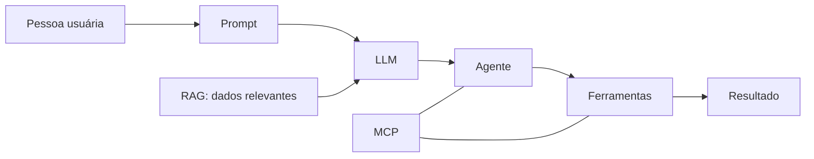
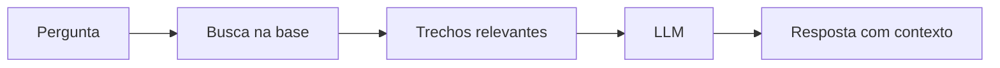
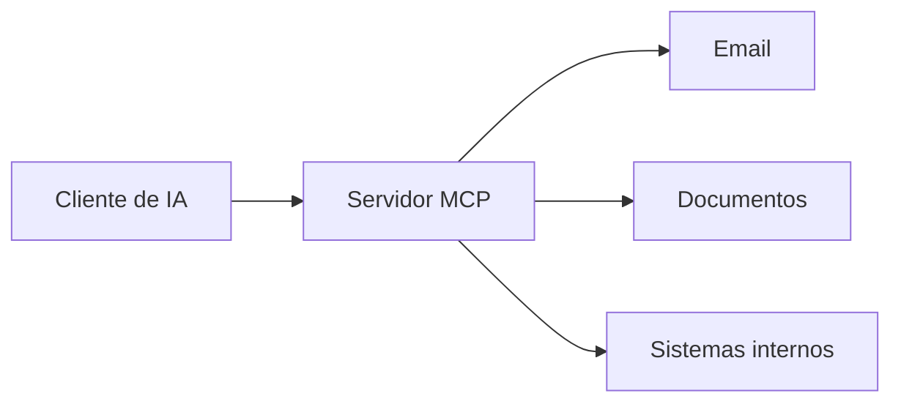

# Fundamentos de IA Generativa

Este tutorial apresenta os principais blocos que compõem aplicações modernas de IA generativa: modelos de linguagem, prompts, recuperação de conhecimento, ferramentas, agentes e protocolos de integração.

O objetivo é criar um mapa mental prático. Você não precisa de matemática avançada nem de código para acompanhar.

## Visão geral

Uma aplicação de IA generativa pode receber uma solicitação, complementar o contexto com fontes confiáveis, decidir se precisa executar uma ação e devolver um resultado.



## 1. Modelos de linguagem de grande porte (LLMs)

Um **Large Language Model** (LLM) é um modelo treinado em grandes coleções de texto para produzir e transformar linguagem. Durante a geração, ele estima quais tokens têm maior probabilidade de continuar uma sequência, considerando o contexto recebido.

Interfaces como chatbots, assistentes de escrita e copilotos costumam usar um LLM como mecanismo central.

### Pontos importantes

- O modelo produz respostas a partir de padrões aprendidos e do contexto enviado na conversa.
- Ele pode gerar conteúdo convincente mesmo quando uma informação está incorreta ou não está disponível.
- O resultado depende do modelo, do prompt, dos dados de contexto e das ferramentas disponíveis.
- Para fatos que exigem precisão ou atualização, use fontes verificáveis e mantenha revisão humana quando necessário.

## 2. Prompts e engenharia de prompts

Um **prompt** é a instrução enviada ao modelo. Um pedido bem estruturado reduz ambiguidades e torna a resposta mais útil.

Uma estrutura simples inclui:

| Elemento | Pergunta que ajuda a escrever | Exemplo |
| --- | --- | --- |
| Papel | Qual perspectiva o modelo deve adotar? | “Atue como analista de RH.” |
| Tarefa | O que deve ser feito? | “Liste os riscos de usar IA.” |
| Contexto | Que fatos, limites ou dados importam? | “Considere uma empresa sem política interna de uso.” |
| Formato | Como a resposta deve ser entregue? | “Use três tópicos curtos.” |

### Exemplo

Prompt pouco específico:

```text
Fale sobre IA.
```

Prompt estruturado:

```text
Atue como analista de RH. Liste três riscos do uso de IA
em uma empresa que ainda não possui política interna.
Use tópicos curtos e inclua uma medida de mitigação para cada risco.
```

Refine o prompt quando a primeira resposta não atender ao objetivo. Acrescente contexto, restrições, exemplos ou critérios de avaliação.

## 3. RAG: geração aumentada por recuperação

**RAG** significa *Retrieval-Augmented Generation*. Antes de responder, a aplicação procura conteúdos relevantes em uma base de conhecimento e entrega esses trechos ao modelo como contexto.

Isso permite que a IA responda com base em documentos privados ou atualizados, como políticas internas, contratos, manuais e artigos técnicos.



### O que RAG resolve

Sem recuperação de conhecimento, um assistente pode não conhecer a versão atual de uma política ou manual. Com RAG, ele consulta a fonte antes de formular a resposta.

RAG não elimina a necessidade de avaliar qualidade. A base precisa ter conteúdo confiável, permissões adequadas, boa indexação e referências que permitam verificar a origem da resposta.

## 4. Ferramentas e uso de ferramentas

Por si só, um modelo de linguagem gera texto. Quando uma aplicação conecta o modelo a **ferramentas**, ela pode executar operações controladas fora da conversa.

Exemplos comuns:

- Pesquisar informações atuais na web.
- Consultar uma API ou sistema interno.
- Criar documentos, planilhas ou relatórios.
- Enviar uma mensagem após confirmação.
- Navegar por uma página para extrair dados.
- Executar código ou análises sobre um conjunto de dados.

Uma ferramenta deve ter uma finalidade clara, limites de acesso e validações antes de qualquer ação sensível. Descreva ao modelo quando usar a ferramenta, quais parâmetros ela aceita e o que fazer caso ela falhe.

## 5. Agentes de IA

Um **agente de IA** coordena um ou mais passos para alcançar um objetivo. Ele pode interpretar a solicitação, buscar contexto, escolher ferramentas, verificar resultados e solicitar intervenção humana quando necessário.

Há um espectro de automação:

| Tipo | Comportamento típico |
| --- | --- |
| Chatbot | Responde a uma pergunta por vez. |
| Assistente | Executa uma sequência de etapas definida. |
| Agente | Planeja e coordena etapas, contexto e ferramentas dentro de limites estabelecidos. |

Casos de uso incluem organizar informações, preparar rascunhos, atender solicitações com consulta a bases autorizadas e monitorar processos. Quanto maior a autonomia, mais importantes se tornam permissões, rastreabilidade, testes e pontos de aprovação humana.

## 6. MCP: Model Context Protocol

O **Model Context Protocol** (MCP) é um protocolo aberto para conectar aplicações de IA a ferramentas e fontes de contexto de forma padronizada.

Em vez de cada aplicação implementar uma integração exclusiva para cada serviço, um servidor MCP pode expor recursos e ferramentas por uma interface comum. Clientes compatíveis conseguem descobrir e usar essas capacidades conforme suas permissões.



MCP não substitui autenticação, autorização ou políticas de segurança. Cada integração continua precisando de controles adequados para os dados e ações que expõe.

## 7. Como os componentes se conectam

Um fluxo típico combina os conceitos deste tutorial:

1. A pessoa usuária envia uma solicitação.
2. O prompt define a tarefa, o contexto e o formato esperado.
3. O LLM interpreta o contexto e prepara uma resposta ou uma próxima ação.
4. Se necessário, RAG recupera documentos relevantes.
5. Um agente coordena as etapas e decide quando usar uma ferramenta.
6. As integrações podem ser disponibilizadas por MCP.
7. A aplicação devolve o resultado e registra as evidências necessárias.

## Boas práticas iniciais

- Comece com um caso de uso pequeno e critérios claros de sucesso.
- Use dados autorizados e aplique o princípio de menor privilégio.
- Exiba fontes quando a resposta depende de recuperação de documentos.
- Valide saídas antes de executar ações externas ou irreversíveis.
- Registre chamadas de ferramentas, resultados e falhas para auditoria.
- Teste situações comuns, ambíguas e adversas antes de ampliar o acesso.
- Mantenha uma pessoa responsável por aprovar mudanças de alto impacto.

## IA no trabalho: benefícios e aplicações práticas

A IA já aparece em vários pontos do trabalho técnico. Além de conversas em linguagem natural, ela pode apoiar a escrita de código, a documentação, a análise de dados e a preparação de alternativas para decisões.

| Área | Aplicações possíveis |
| --- | --- |
| Código | Autocompletar trechos, explicar código, sugerir testes e revisar alterações. |
| Documentação | Criar rascunhos de READMEs, docstrings, resumos e notas de versão. |
| Dados | Resumir resultados, identificar padrões e preparar relatórios exploratórios. |
| Decisões | Organizar contexto, comparar opções e listar riscos ou perguntas em aberto. |

### Tarefas repetitivas

Comece por atividades frequentes que exigem pouco julgamento novo. A IA pode reduzir o esforço mecânico e liberar tempo para análise, validação e decisões.

- Gerar código repetitivo, estruturas iniciais e exemplos.
- Classificar solicitações e sugerir uma prioridade para triagem humana.
- Preparar rascunhos de atualizações de status e comunicações técnicas.
- Resumir logs, discussões longas e relatórios recorrentes.
- Preencher partes previsíveis de documentos a partir de um contexto fornecido.

Defina o resultado esperado, os limites da automação e quem valida a saída. A responsabilidade pela decisão continua com a pessoa ou equipe responsável.

### Do copiloto ao agente

O nível de autonomia deve acompanhar a clareza e o risco da tarefa.

| Nível | Uso adequado |
| --- | --- |
| Assistência direta | Responder perguntas, explicar erros e gerar um rascunho sob comando. |
| Automação de rotina | Executar uma sequência estável, como classificar uma solicitação e preparar um texto. |
| Agentes encadeados | Coordenar etapas conectadas, ferramentas e aprovações para concluir um fluxo maior. |

Exemplos de fluxos automatizados incluem revisar uma alteração, resumir as diferenças e notificar o time, ou classificar uma solicitação, sugerir prioridade e preparar uma resposta para revisão. Use aprovação humana antes de ações que mudem sistemas, publiquem conteúdo ou afetem pessoas.

### Análise, consistência e apoio à decisão

A IA consegue processar muito conteúdo com rapidez e aplicar um conjunto de critérios de forma consistente. Ela ajuda a encontrar pontos que merecem atenção, mas não conhece todos os fatores do contexto nem assume a responsabilidade pela decisão.

Ela pode auxiliar a:

- Resumir contratos, especificações e documentos de produto extensos.
- Comparar versões de código, changelogs e requisitos.
- Destacar erros, padrões, anomalias ou possíveis violações de níveis de serviço em logs.
- Verificar aderência a convenções de código e listas de verificação.

Valide a fonte, os critérios usados e as conclusões. Em tarefas de alto impacto, trate a resposta como insumo para a decisão, não como decisão final.

### Conhecimento e comunicação

A IA reduz a barreira inicial para investigar assuntos técnicos. Ela pode explicar uma mensagem de erro, oferecer uma visão geral de uma base de código desconhecida ou transformar detalhes técnicos em uma comunicação mais clara.

Use esse apoio para acelerar a aprendizagem, mantendo o hábito de consultar documentação oficial, testar hipóteses e confirmar as informações no ambiente relevante. Revise qualquer conteúdo gerado antes de compartilhá-lo.

### Integração ao fluxo de trabalho

O maior ganho surge quando a IA entra em ferramentas que a equipe já usa, como editores de código, bases de documentação, sistemas de tarefas e canais de comunicação.

Antes de integrar uma nova capacidade:

1. Escolha um fluxo específico e mensurável.
2. Defina quais dados podem ser enviados e quais devem permanecer restritos.
3. Estabeleça permissões mínimas para cada ferramenta.
4. Teste resultados com casos reais, incluindo falhas e entradas ambíguas.
5. Acompanhe qualidade, tempo economizado e necessidade de revisão.

Uma integração bem delimitada aumenta a velocidade e a consistência sem perder contexto, responsabilidade e qualidade.

## Pontos de atenção ao usar IA

Use a IA para apoiar o trabalho, mas mantenha senso crítico sobre as respostas, os dados e as ações que ela pode executar. O conteúdo gerado pode parecer correto e ainda conter erros, lacunas ou premissas inadequadas.

### Alucinações

Uma **alucinação** ocorre quando o modelo apresenta informação incorreta com aparência de certeza. Ela pode aparecer como um trecho de código plausível, uma API inexistente, uma fonte que não existe ou uma explicação técnica coerente, porém errada.

Antes de aplicar uma resposta em algo importante:

- Confirme fatos em fontes primárias ou documentação oficial.
- Teste o código e valide o comportamento no ambiente adequado.
- Verifique links, citações, dependências e nomes de APIs.
- Peça ao modelo para indicar incertezas e suposições, sem tratar isso como substituto para a verificação.

### Viés, lacunas e informação desatualizada

Uma resposta pode ser bem escrita e ainda não representar seu contexto. Os dados de treinamento e as fontes recuperadas podem conter vieses, ter cobertura desigual ou não incluir mudanças recentes.

| Risco | Pergunta de verificação |
| --- | --- |
| Contexto ausente | A resposta considera as regras, a arquitetura e as restrições do meu ambiente? |
| Informação antiga | As versões, normas e práticas citadas ainda são válidas? |
| Cobertura incompleta | Há casos extremos, outros idiomas ou públicos que ficaram de fora? |
| Viés | A recomendação faz generalizações ou reproduz estereótipos? |

Forneça o contexto necessário, compare alternativas e inclua pessoas com conhecimento do domínio nas revisões relevantes.

### Autonomia e senso crítico

Ganhar velocidade não deve reduzir a capacidade de entender e resolver problemas. Aceite uma sugestão somente quando conseguir explicar o que ela faz, por que se aplica ao caso e como você verificou seu resultado.

Evite recorrer à IA antes de investigar o problema, copiar código que não consegue justificar ou deixar de praticar depuração. Use-a para acelerar a aprendizagem e o trabalho, não para delegar o entendimento.

### Segurança, privacidade e confidencialidade

Como regra prática, não envie a uma ferramenta de IA informações que você não publicaria em um fórum público, a menos que ela tenha sido aprovada para esse tipo de dado e ofereça os controles exigidos.

Proteja especialmente:

- Credenciais, tokens, senhas e chaves de API.
- Dados pessoais e registros de clientes ou usuários.
- Código, documentos e contratos confidenciais.
- Informações estratégicas, acordos de confidencialidade e logs com identificadores sensíveis.

Antes de usar uma ferramenta, confirme onde os dados serão processados, se os dados podem ser usados para treinamento, quais controles de retenção e acesso existem e se há registro de auditoria.

### Prompts e iteração

Prompts vagos produzem respostas genéricas. Explique o contexto, o objetivo, as restrições técnicas e o formato desejado.

Se a resposta vier incompleta, peça mais detalhes. Se vier errada, informe o erro observado e solicite uma correção. Teste o resultado antes de adotá-lo. Trate a conversa como um ciclo de iteração, não como uma consulta a uma fonte infalível.

### Governança em equipe

Times precisam de regras compartilhadas para usar IA de forma segura e consistente.

1. Defina ferramentas aprovadas, tipos de dados permitidos e dados proibidos.
2. Exija revisão humana para código, decisões e entregas de alto impacto.
3. Registre quando a IA influenciar decisões relevantes ou produzir partes significativas de uma entrega.
4. Mantenha permissões mínimas e monitore o uso das integrações.
5. Atualize as orientações conforme surgirem novos riscos, ferramentas ou requisitos.

Transparência e revisão tornam o uso de IA mais confiável e facilitam a responsabilização quando algo precisa ser corrigido.

## Próximos passos

Escolha um processo simples, descreva a tarefa em um prompt estruturado e defina quais fontes ou ferramentas seriam realmente necessárias. Depois, avalie o resultado com exemplos reais e ajuste o fluxo antes de automatizar mais etapas.

## Licença

Adicione uma licença apropriada antes de reutilizar este material em outros projetos.
